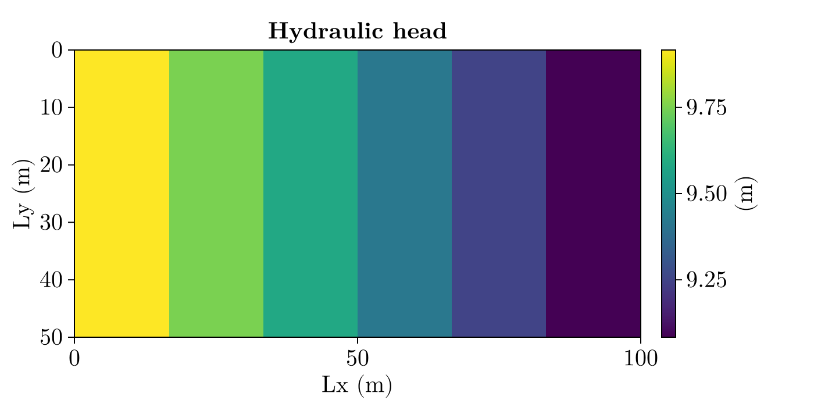
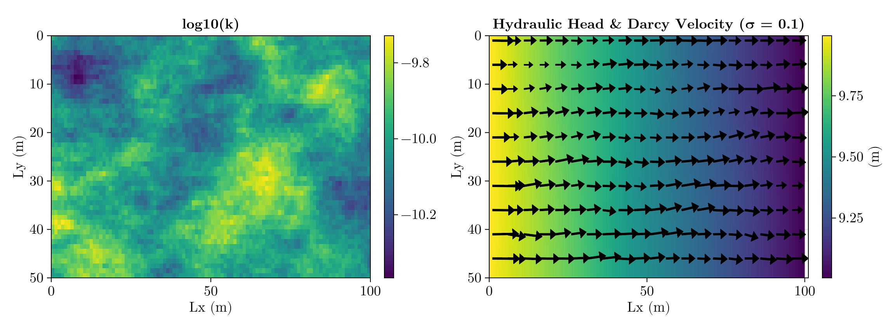
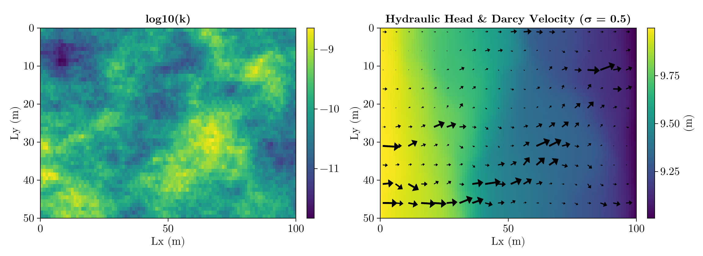
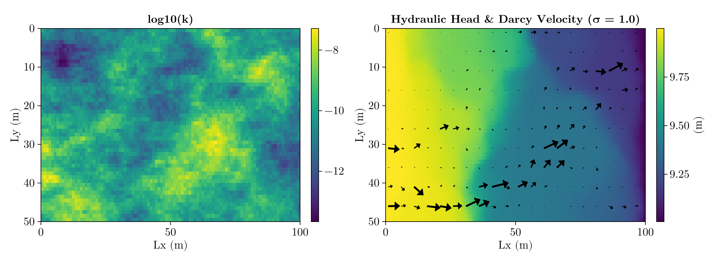
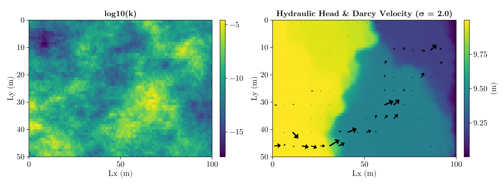

# Homework 4: 2-D Groundwater Flow in Heterogeneous Aquafers

Viet M. Bui,
2026-09-22,
GLY 6826 - Hydrogeologic Modeling

Code source: [gh:vietbuiminh/hydro-modeling/](https://github.com/vietbuiminh/hydro-modeling/)

> This matter because you can view my commits history
---

**Problem 1**

Given:
- $h_L = 10 m$ (Dirichlet),
- $h_R = 9 m$ (Dirichlet),
- $\rho = 1000\ kg/m^3$, $\mu = 1.0\times10^{-3}\ Pa\cdot s$, $g = 9.81\ m/s^2$,
- $k = 10^{-10}\ m^2$ (homogeneous),
- $n_x = 6$, $n_y = 3$ $\implies \delta x = \delta y = \frac{50}{3}\ m$,
- top and bottom boundaries are no-flow (Neumann)

Hydraulic conductivity:

$$
K = \frac{\rho g k}{\mu} = \frac{1000 \cdot 9.81 \cdot 1.0\times10^{-10}}{1.0\times10^{-3}} = 9.81\times10^{-4}\ m/s
$$

Please referering to 
> Problem1-2D-GWF-nx6-ny3-vietbui.pdf

**Problem 2**

Please refering to 
> [Dirichlet2D-discretize.jl](Dirichlet2D-discretize.jl)

The two dimensional plot of hydraulic head $h(x,y)$ is shown in Figure 1. Since this is a linear system, the pattern result are a linear gradient going from the left boundary to the right boundary. 

For a homogenous aquifer where the top and bottom boundary doesn't allow flow, this is consistent with what I would expect with the given conditions. 

**Problem 3**
> [2D-discretize with input](/Neumann2D-discretize.jlNeumann)

Since $\sigma$ is the scaling factor for the spatial field $Y$ with the scale reduced to 10%, we can expect the field to close to a linear gradient pattern as seen in Problem 2 but with the minor variance across the field. This is represented in the display of the darcy velocity of the quiver plot overlaid the heatmap in Figure 2.

Because it increase the scaling up to 50% in Figure 3 with $\sigma = 0.5$, here the plot of the hydraulic head have a more spatial-difference and distinct geometry across the domain where the cluster of darcy velocity instead of close to uniformly distributed across the domain, it is now forming 2 pathways.

Whereas this pattern continue to migrate from 2 paths into 1 path when the scalling of $\sigma$ approaching 2 (Figure 4, and 5).

All of the arrow shown in the Figure 2-5 are scalled up by 2.