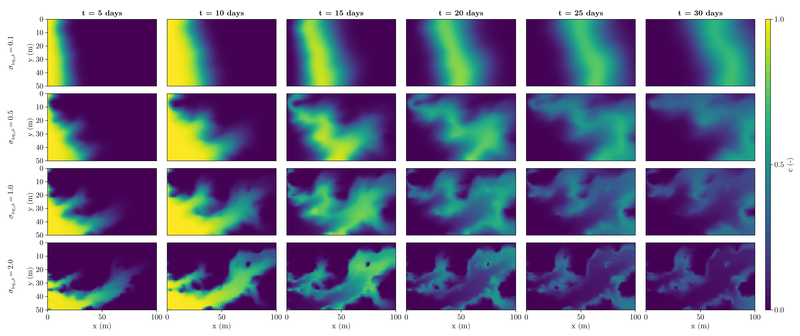
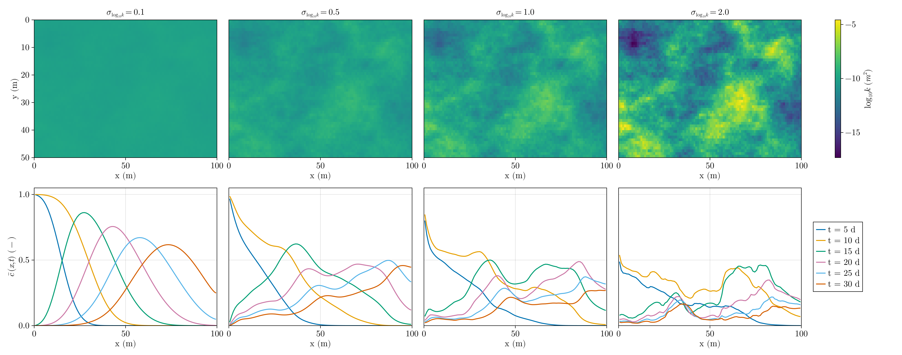

# Homework 5: 2-D Solute Transport in Heterogeneous Aquifers 

Viet M. Bui,
2026-10-06,
GLY 6826 - Hydrogeologic Modeling

Code source: [gh:vietbuiminh/hydro-modeling/](https://github.com/vietbuiminh/hydro-modeling/)

> This matter because you can view my commits history
---

**Problem 1**

> [hw5-p1.jl](hw5-p1.jl) (flow and transport solvers in [funcs/flow_transport_2d.jl](funcs/flow_transport_2d.jl))

Given:

- $h_L = 10\ m$, $h_R = 9\ m$ (Dirichlet), no flow top and bottom boundaries,

- $k = 10^{-10}\ m^2$ (homog.) ($\implies K = \frac{\rho g k}{\mu} = 9.81\times10^{-4}\ m/s$),

- $n_x = 100$, $n_y = 50, \delta x = \delta y = 1\ m$,

Assume:  

- $\phi = 0.3$, $D_{diff} = 1.0\times10^{-9}\ m^2/s$, $\alpha = 1.0\ m$,

Initial concentration field:

- $c = 1$ on the left (inflow) boundary for $t \le 10$ days, $c = 0$ afterward; $\partial c/\partial x = 0$ (concentration-gradient condition) at the right outlet; zero advective and dispersive flux at the top and bottom.

Inside the `hw5-p1.jl`

```jl
# physical properties
ρ = 1000 # water density [kg/m^3]
μ = 1.0e-3 # dynamic viscosity [Pa s]
g = 9.81 # gravitational acceleration [m/s^2]
k = 1.0e-10 # intrinsic permeability [m^2]

ϕ = 0.3 # porosity [-]
D_diff = 1.0e-9 # molecular diffusion coeff. [m^2/s]
α = 1.0 # isotropic dispersivity [m]

# model domain
Lx = 100 # domain length in x direction [m]
Ly = 50 # domain length in y direction [m]
nx = 100 # number of cells in x direction
ny = 50 # number of cells in y direction
dx = Lx / nx # = 1 m
dy = Ly / ny # = 1 m

# boundary conditions
hL = 10 # left boundary head [m] (Dirichlet)
hR = 9 # right boundary head [m] (Dirichlet)
day = 24 * 60 * 60 # [s]
c_in(t) = t < 10 * day ? 1.0 : 0.0 # inject c = 1 for the first 10 days
```

The flow solver is the one I wrote for HW4 Problem 3 in [Neumann2D-discretize.jl](Neumann2D-discretize.jl). There, the whole solve sat inside a `for σ in σ_ls` loop over the standard deviations. For this homework I turned that core code into functions in [funcs/flow_transport_2d.jl](funcs/flow_transport_2d.jl). `solve_flow(Kmat, dx, dy, hL, hR)` builds the transmissibility matrix, solves for the head, and returns the Darcy velocities on every cell face. `solve_transport(flow, dx, dy, ϕ, D_diff, α, c_in, tsave)` takes those face velocities and steps the concentration field through time, saving it at the requested times. Problem 1 with the homogeneous $K$.

- Plot two-dimensional concentration fields at t = 5, 10, 15, 20, 25, and 30 days using 
the same color scale, 0<=c<=1 


- Calculate  and  plot  the  transverse-averaged  concentration at the same times. 


- Compare  the  simulated  plume  travel  speed  with  the  expected  mean  pore  velocity

*Expected mean pore velocity.* From the total inflow at the left boundary,

$$
\bar u_x = \frac{1}{L_y}\int_0^{L_y} u_x(0,y)\,dy = 9.81\times10^{-6}\ m/s
$$

$$
\bar v_x = \frac{\bar u_x}{\phi} = 3.27\times10^{-5}\ m/s = 2.825\ m/day
$$

As seen in figure 2, to measure how fast the simulated plume moves, I can track the top of the curve and how the max position shift every day (Figure 3):

- the leading front, where $\bar c = 0.5$, which should sit at $\bar v_x t$;

- the peak (maximum) of $\bar c$. During injection the peak stays at the inlet, where $\bar c = 1$. After injection stops, the peak should move with the center of the 10day slug, $\bar v_x (t - 10\ \text{days})$.


Since we can see the track lines and scatter dot from both paralell after passing day 10th, the speed the simulated can be averaged to be similar with the expected mean pore velocity $2.825\ m/day$

- Does the plume remain uniform in the transverse direction?

Yes because every column of Figure 1 has a single concentration. With homogeneous $k$ and no-flow top and bottom boundaries, $u_y = 0$ everywhere and there is no transverse concentration gradient, so the problem is linear in $x$.

- Is its movement consistent with the calculated mean pore velocity $\bar v_x$?

Yes, and the front moves at $2.83\ m/day$, matching $\bar v_x = 2.825\ m/day$ (Figure 3). The plume spreads out as it moves which is dispersivity (Figure 2 as seen in concentration).

- Does the numerical solution remain within $0 \le c \le 1$? 

Yes. Over all saved times $c_{min} = 0$ (no negative values) and $c_{max} = 0.99996$.

**Problem 2**

> [hw5-p2.jl](hw5-p2.jl) (same solvers as Problem 1, [funcs/flow_transport_2d.jl](funcs/flow_transport_2d.jl))

The $\log_{10}k$ field in `permeability_field.csv` has mean $-10.000$ and standard deviation $1.000$, as stated, so

$$
Y = \frac{\log_{10}k + 10}{1}, \qquad \log_{10}k = -10 + \sigma_{\log_{10}k}\,Y, \qquad \sigma_{\log_{10}k} = 0.1,\ 0.5,\ 1,\ 2
$$

- Plot two-dimensional concentration fields at t = 5, 10, 15, 20, 25, and 30 days using the same color scale, 



- Calculate and plot the transverse-averaged concentration



- At every saved time, calculate the longitudinal centroid ($\bar{x}$) and the longitudinal variance ($\sigma_{x}^2$)

```jl
centroid(c) = sum(X .* c) / sum(c)
variance(c) = sqrt(sum((X .- centroid(c)) .^ 2 .* c) / sum(c))
```

- How does increasing permeability heterogeneity change the geometry of the solute plume?

The more heterogeneous the field, the less uniform the plume as seen in Figure 5.

The $\bar c$ profiles (Figure 4, bottom row) go from a smooth bell shape at 0.1 to a long tail with several peaks at 1 and 2.

- Does the plume centroid $\bar x$ move faster or slower as $\sigma_{\log_{10}k}$ increases?

Faster. In Figure 6 (left), the curve gets steeper as $\sigma_{\log_{10}k}$ increases: $\bar x$ reaches 50 m after about 21 days for 0.1, but after only about 11 days for 2. 

In Figure 5, most of the solute rides the fast high-$k$ channels.

At late times the curves for 1 and 2 flatten out, and the one for 2 even drops. The plume isn't slowing down. Its fast front has already left through the outlet (Figure 5, bottom rows), so $\bar x$ only measures the slow solute left behind.

- Plot $\sigma_x$ as a function of $\bar x$, and the comparison at $\bar x = 50\ m$.


$\sigma_x$ at $\bar x = 50\ m$, interpolated linearly between the two saved days on either side.

Figure 6 right, all four curves follow nearly the same line during injection where the plume is still attached to the inlet, so $\sigma_x$ mostly reflects the growing length of the slug. 

Once injection stops after day 10 (Figure 6 right where the lines following different curve trend) the curves separate in the leading Figure 6 (right).

- How does longitudinal spreading, $\sigma_x$, change with heterogeneity?

$\sigma_x$ increases with heterogeneity: in Figure 6 (right), the curve sits higher as $\sigma_{\log_{10}k}$ increases. At $\bar x = 50\ m$ it goes 15 to 26 m. The biggest jump is from 0.1 to 0.5. After that the curves bunch together, partly because the fastest solute has already left through the outlet and no longer counts toward $\sigma_x$.

- Why is comparing $\sigma_x$ at the same centroid location more informative than at the same elapsed time?

A plume spreads more the farther it travels where the complexity of it spread depending on the heterogenity. In Figure 6 (left), at the same time the more heterogeneous plumes have already traveled farther, because their flow becomes 2D and channelled instead of 1D in $x$. Comparing at the same $\bar x$ puts every plume at the same travel distance, so the difference in $\sigma_x$ comes from heterogeneity alone.

- At which heterogeneity level does preferential transport become clearly visible?

At $\sigma_{\log_{10}k} = 0.5$. In Figure 4, the 0.1 plume is still one even band, but at 0.5 the solute clearly runs ahead along the high-$k$ lower half. In Figure 5 (bottom row), $\bar c$ also loses its smooth bell shape at 0.5. From 1 upward, a few channels carry most of the solute.

In all four runs the concentration stays within $0 \le c \le 1$.
