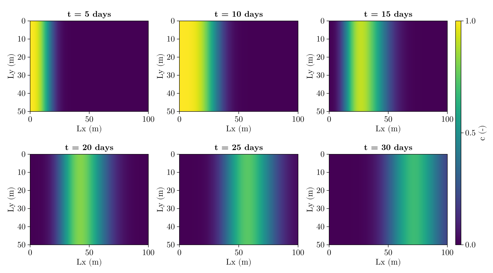
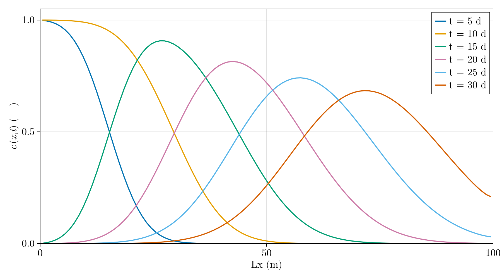
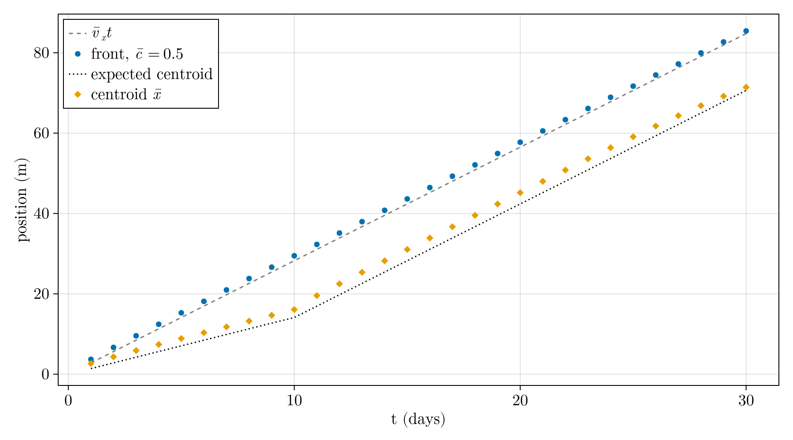
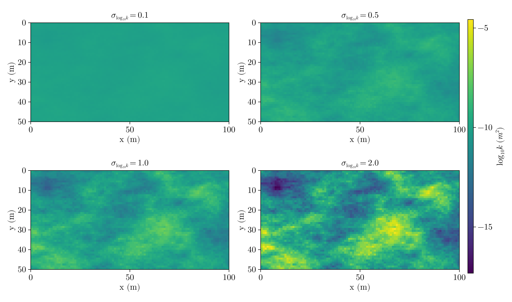
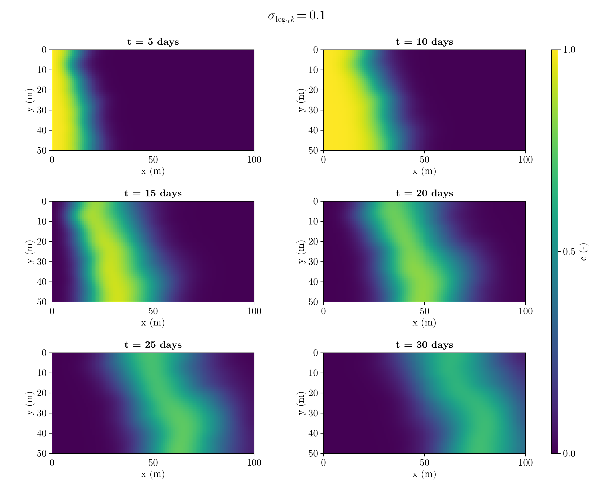
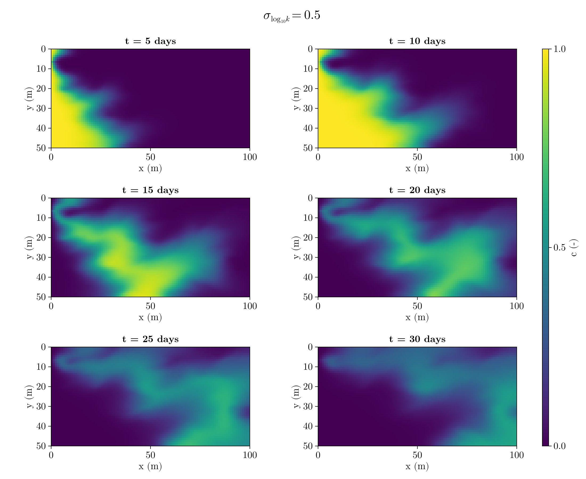
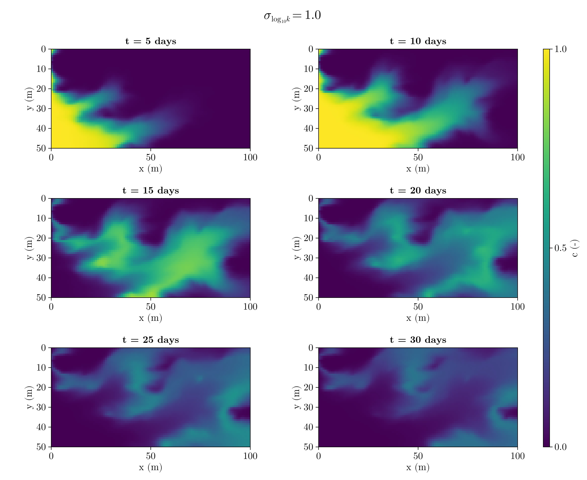
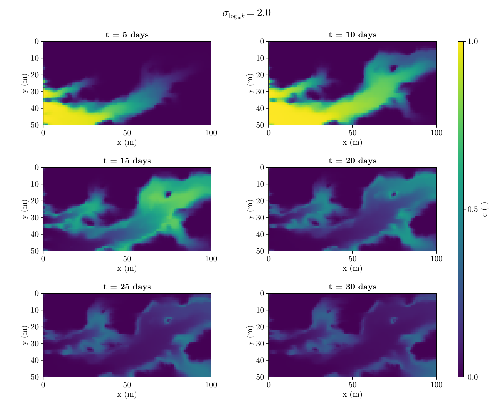
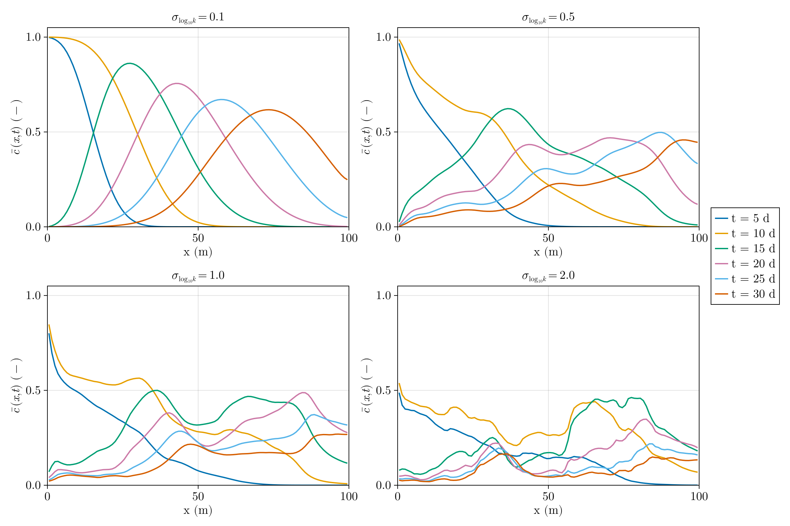
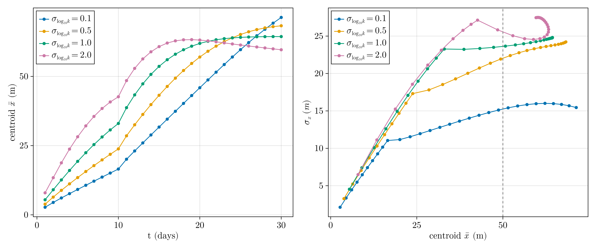

# Homework 5: 2-D Solute Transport in Heterogeneous Aquifers 

Viet M. Bui,
2026-10-06,
GLY 6826 - Hydrogeologic Modeling

Code source: [gh:vietbuiminh/hydro-modeling/](https://github.com/vietbuiminh/hydro-modeling/)

> This matter because you can view my commits history
---

**Problem 1**

> [hw5-p1.jl](hw5-p1.jl) (flow and transport solvers in [funcs/flow_transport_2d.jl](funcs/flow_transport_2d.jl))

Given:
- $h_L = 10\ m$, $h_R = 9\ m$ (Dirichlet), top and bottom no-flow,
- $k = 10^{-10}\ m^2$ (homogeneous) $\implies K = \frac{\rho g k}{\mu} = 9.81\times10^{-4}\ m/s$,
- $n_x = 100$, $n_y = 50 \implies \delta x = \delta y = 1\ m$,
- $\phi = 0.3$, $D_{diff} = 1.0\times10^{-9}\ m^2/s$, $\alpha = 1.0\ m$,
- $c = 1$ on the left (inflow) boundary for $t \le 10$ days, $c = 0$ afterward; $\partial c/\partial x = 0$ at the right outlet; zero advective and dispersive flux at the top and bottom.

*Flow.* The steady-state flow is solved with the same TPFA finite-volume scheme as HW4, and the Darcy velocities are kept on every cell face. Because the aquifer is homogeneous, the head drops linearly from 9.995 m (first cell) to 9.005 m (last cell), and the flow is purely in $x$ ($\max|u_y| \approx 10^{-17}\ m/s$, i.e. round-off):

$$
u_x = K\frac{h_L - h_R}{L_x} = 9.81\times10^{-4}\cdot\frac{1}{100} = 9.81\times10^{-6}\ m/s
$$

*Transport.* The advective flux on each face is $u\,c$ with $c$ taken from the upwind cell (or $c_{in}$ on the left boundary). The dispersive flux is $\phi D_h \Delta c/\delta$ between the two cell centers, with $D_h$ on interior faces given by the harmonic mean of the two cells. On the inlet face the distance is half a cell. The concentration is advanced with forward Euler, $c^{n+1} = c^n - \frac{\delta t}{\phi\,\delta x\,\delta y}\sum(\text{net outflow})$. The last step before each output time is shortened so the output lands exactly on that time.

The pore velocity is uniform, so $D_h = D_{diff} + \alpha|\bar v| = 3.27\times10^{-5}\ m^2/s$ everywhere, and

$$
\delta t_{adv} = \frac{0.1\cdot 1}{3.27\times10^{-5}} = 3058\ s, \qquad
\delta t_{disp} = \frac{0.1}{3.27\times10^{-5}\,(1 + 1)} = 1529\ s
$$

so dispersion controls the time step: $\delta t = 1529\ s \approx 25$ minutes, which gives about 1700 steps over 30 days.

*Expected mean pore velocity.* From the total inflow at the left boundary,

$$
\bar u_x = \frac{1}{L_y}\int_0^{L_y} u_x(0,y)\,dy = 9.81\times10^{-6}\ m/s, \qquad
\bar v_x = \frac{\bar u_x}{\phi} = 3.27\times10^{-5}\ m/s = 2.825\ m/day
$$

To measure how fast the simulated plume moves, I tracked two positions from $\bar c(x,t)$ every day (Figure 3):
- the leading front, where $\bar c = 0.5$, which should sit at $\bar v_x t$;
- the plume centroid $\bar x = \sum x_i \bar c_i / \sum \bar c_i$. For a 10-day slug this should be $\bar v_x t/2$ during injection and $\bar v_x (t - 5\ \text{days})$ afterward (the middle of the slug).

| t (days) | front, $\bar c = 0.5$ (m) | $\bar v_x t$ (m) | centroid $\bar x$ (m) | expected $\bar x$ (m) | peak $\bar c$ |
|---|---|---|---|---|---|
| 5  | 15.29 | 14.13 | 8.88  | 7.06  | 0.999 |
| 10 | 29.48 | 28.25 | 16.10 | 14.13 | 1.000 |
| 15 | 43.63 | 42.38 | 31.05 | 28.25 | 0.907 |
| 20 | 57.74 | 56.51 | 45.18 | 42.38 | 0.815 |
| 25 | 71.70 | 70.63 | 59.10 | 56.51 | 0.742 |
| 30 | 85.43 | 84.76 | 71.42 | 70.63 | 0.684 |

Simulated plume speeds:
- front, days 5–20: $2.830\ m/day$
- centroid, days 12–22 (after injection stops and before the plume reaches the outlet): $2.831\ m/day$

Both are within 0.2% of $\bar v_x = 2.825\ m/day$.

The front stays about 1.2 m ahead of $\bar v_x t$ and the centroid about 2.8 m ahead of its expected position. These are constant offsets, not a difference in speed, and they come from dispersion at the inlet. During injection, solute also enters by dispersion through the fixed-concentration ($c = 1$) inlet, on top of the advective flux $u c_{in}$. By day 10 the solute mass in the domain is 4.7% more than the advective input $\bar u_x L_y \cdot 10\ \text{days}$. After injection stops, some solute at the tail disperses back out through the inlet, and the mass returns to 1.000 of the advective input. Both effects push the solute mass forward. After about day 23 the mass in the domain starts to drop as the leading edge leaves through the outlet (0.944 of the input remains at day 30). This also pulls the centroid back toward its expected value at late times.

*Questions*

- **Does the plume remain uniform in the transverse direction?** Yes. Every column of Figure 1 has a single concentration; the largest difference between any cell and its column average, $\max|c - \bar c|$, is $1.7\times10^{-12}$ (round-off). With homogeneous $k$ and no-flow top and bottom boundaries, $u_y = 0$ everywhere and there is no transverse concentration gradient, so the problem is effectively 1-D in $x$.

- **Is its movement consistent with the calculated mean pore velocity $\bar v_x$?** Yes. The front and the centroid both move at $2.83\ m/day$, matching $\bar v_x = 2.825\ m/day$ (Figure 3). The plume spreads as it moves: the peak $\bar c$ falls from 1.0 to 0.68 by day 30 (Figure 2). The physical dispersivity ($\alpha = 1\ m$) causes most of this spreading. The first-order upwind scheme adds some numerical dispersion on top; I estimate this at roughly $\delta x/2 \approx 0.5\ m$ of extra dispersivity.

- **Does the numerical solution remain within $0 \le c \le 1$?** Yes. Over all saved times $c_{min} = 0$ (no negative values) and $c_{max} = 0.99996$. The scheme cannot overshoot here: with first-order upwinding and a time step well inside both limits (Courant number $\bar v\,\delta t/\delta x = 0.05$, and $D_h\,\delta t/\delta x^2 = 0.05$ in each direction), each new concentration is a weighted average of the old values in the cell and its neighbours, with non-negative weights.

**Problem 2**

> [hw5-p2.jl](hw5-p2.jl) (same solvers as Problem 1, [funcs/flow_transport_2d.jl](funcs/flow_transport_2d.jl))

The $\log_{10}k$ field in `permeability_field.csv` has mean $-10.000$ and standard deviation $1.000$, as stated, so

$$
Y = \frac{\log_{10}k + 10}{1}, \qquad \log_{10}k = -10 + \sigma_{\log_{10}k}\,Y, \qquad \sigma_{\log_{10}k} = 0.1,\ 0.5,\ 1,\ 2
$$

The same $Y$ is used for all four runs, so only the contrast changes (Figure 4). Everything else is the same as Problem 1: Dirichlet heads $h_L = 10\ m$ and $h_R = 9\ m$, $c = 1$ injected at the left boundary for 10 days, zero-gradient outlet, and no-flux top and bottom. Because $D_h = D_{diff} + \alpha|\bar v|$, the time step shrinks as the fastest cell gets faster.

| $\sigma_{\log_{10}k}$ | $K$ range (m/s) | $\bar v_x$ (m/day) | $\max\lvert\bar v\rvert$ (m/day) | $\delta t$ (s) |
|---|---|---|---|---|
| 0.1 | $4.2\times10^{-4}$ – $1.8\times10^{-3}$ | 2.84 | 4.40 | 983 |
| 0.5 | $1.4\times10^{-5}$ – $2.2\times10^{-2}$ | 3.10 | 16.6 | 260 |
| 1   | $2.1\times10^{-7}$ – $5.1\times10^{-1}$ | 3.30 | 36.5 | 118 |
| 2   | $4.7\times10^{-11}$ – $2.6\times10^{2}$ | 3.09 | 65.9 | 66 |

Here $\bar v_x = \bar u_x/\phi$ is computed from the total inflow at the left boundary, as in Problem 1. The mean of $\log_{10}k$ is the same in all four fields, and the mean pore velocity changes by only about 15%, even though $K$ spans 13 orders of magnitude at $\sigma_{\log_{10}k} = 2$.

*Moments.* $\bar x$ and $\sigma_x$ are computed from $\bar c(x,t)$ with the formulas in the assignment, every day from day 1 to day 30. The table also lists the solute mass still in the domain, divided by the mass that entered with the flow ($\bar u_x L_y \cdot 10$ days). Once part of the plume has left through the outlet, $\bar x$ and $\sigma_x$ describe only what remains.

| t (days) | $\bar x$ (m) 0.1 / 0.5 / 1 / 2 | $\sigma_x$ (m) 0.1 / 0.5 / 1 / 2 | mass in domain 0.1 / 0.5 / 1 / 2 |
|---|---|---|---|
| 5  | 9.2 / 13.5 / 19.3 / 28.2  | 6.5 / 10.3 / 15.0 / 21.1  | 0.55 / 0.54 / 0.53 / 0.52 |
| 10 | 16.5 / 23.8 / 33.0 / 42.7 | 11.0 / 17.3 / 23.3 / 27.1 | 1.05 / 1.04 / 1.03 / 0.98 |
| 15 | 31.7 / 43.2 / 53.6 / 60.8 | 12.8 / 20.7 / 23.8 / 24.7 | 1.00 / 1.00 / 0.95 / 0.77 |
| 20 | 45.9 / 57.0 / 61.9 / 63.1 | 14.8 / 23.1 / 24.5 / 26.2 | 1.00 / 0.97 / 0.79 / 0.49 |
| 25 | 59.7 / 65.1 / 64.1 / 61.3 | 16.0 / 23.8 / 24.7 / 27.3 | 0.99 / 0.84 / 0.58 / 0.34 |
| 30 | 71.3 / 68.3 / 64.4 / 59.6 | 15.5 / 24.2 / 24.8 / 27.5 | 0.93 / 0.64 / 0.42 / 0.26 |

$\sigma_x$ at $\bar x = 50\ m$, interpolated linearly between the two saved days on either side:

| $\sigma_{\log_{10}k}$ | time to reach $\bar x = 50\ m$ (days) | $\sigma_x$ at $\bar x = 50\ m$ (m) | mass still in domain |
|---|---|---|---|
| 0.1 | 21.5 | 15.3 | 0.999 |
| 0.5 | 17.2 | 22.0 | 0.994 |
| 1   | 13.8 | 23.6 | 0.975 |
| 2   | 11.3 | 25.6 | 0.931 |

*Questions*

- **How does increasing permeability heterogeneity change the geometry of the solute plume?** At $\sigma_{\log_{10}k} = 0.1$ (Figure 5) the plume still looks like the homogeneous case in Problem 1. It is a single band across the whole width, and its front is only slightly tilted and wavy. At $\sigma_{\log_{10}k} = 0.5$ (Figure 6) the front becomes fingered. Solute moves ahead along the higher-$k$ lower half of the domain ($y \approx 25$–$50\ m$), and the low-$k$ zone near the top-left inlet lags behind. At $\sigma_{\log_{10}k} = 1$ (Figure 7) the plume breaks into a few channels, with low-$k$ zones that the solute flows around and that stay nearly clean. At $\sigma_{\log_{10}k} = 2$ (Figure 8) almost all the solute travels in one high-$k$ channel. It enters at $y \approx 30$–$50\ m$, passes through the high-$k$ zone near $(60, 30)$ and leaves at the upper right. By day 10 it already reaches the outlet while most of the domain has never seen solute. The $\bar c$ profiles (Figure 9) show the same change. They go from smooth bell shapes at 0.1 to a long tail and several peaks at 1 and 2, with solute spread over the whole length of the domain.

- **Does the plume centroid $\bar x$ move faster or slower as $\sigma_{\log_{10}k}$ increases?** Faster, at least while the plume is still inside the domain. At day 5, $\bar x$ = 9.2, 13.5, 19.3 and 28.2 m, and the time to reach $\bar x = 50\ m$ falls from 21.5 to 11.3 days. This happens even though $\bar v_x$ barely changes (2.8–3.3 m/day). The reason is that solute is injected by flux, so most of it enters where the inflow is fastest. The flux-weighted inlet pore velocity $\sum u_L^2 / (\phi \sum u_L)$ rises from 3.0 to 6.5, 14.2 and 29.8 m/day, and most of the solute mass rides the fast channels. At late times $\bar x$ stops growing for $\sigma_{\log_{10}k} \ge 1$, and even moves back for 2 (Figure 10, left). This is not the plume slowing down. The leading part has left through the outlet (only 26% of the mass remains at day 30 for $\sigma_{\log_{10}k} = 2$), so the centroid only describes the slow material left behind.

- **$\sigma_x$ as a function of $\bar x$, and the comparison at $\bar x = 50\ m$.** See Figure 10 (right) and the table above: $\sigma_x(\bar x = 50\ m)$ = 15.3, 22.0, 23.6 and 25.6 m. Up to $\bar x \approx 10$–$15\ m$ all four curves follow nearly the same line. During injection the plume is still attached to the inlet, so $\sigma_x$ mostly reflects the growing length of the slug. Once injection stops, the curves separate.

- **How does longitudinal spreading, $\sigma_x$, change with heterogeneity?** $\sigma_x$ increases with heterogeneity. The biggest jump is from 0.1 to 0.5 (15 → 22 m at $\bar x = 50\ m$); after that it increases more slowly (24 and 26 m). The slowdown is partly real and partly an artifact of the finite domain. The domain is only 100 m long, so once the fast part of a strongly heterogeneous plume exits it no longer counts toward $\sigma_x$. At $\bar x = 50\ m$, 7% of the mass has already left for $\sigma_{\log_{10}k} = 2$, so its $\sigma_x$ is an underestimate. In an infinitely long domain the difference between the four levels would be larger.

- **Why is comparing $\sigma_x$ at the same centroid location more informative than at the same elapsed time?** Spreading grows with the distance the plume has traveled. Because the centroid moves faster as heterogeneity increases, at the same elapsed time the more heterogeneous plumes have simply traveled farther. A same-time comparison mixes "spreads more per meter traveled" with "has traveled more meters". At day 10, for example, the plume for $\sigma_{\log_{10}k} = 2$ has a centroid at 42.7 m, while the one for 0.1 is only at 16.5 m. At later times the comparison gets worse, because the fast plumes have lost mass through the outlet and their $\sigma_x$ is truncated. Comparing at the same $\bar x$ puts every plume at the same travel distance, so the difference in $\sigma_x$ reflects only how heterogeneity spreads the solute.

- **At which heterogeneity level does preferential transport become clearly visible?** At $\sigma_{\log_{10}k} = 0.5$. At 0.1 the front is only slightly tilted, and $\bar c(x,t)$ keeps the same smooth, symmetric shape as in the homogeneous case. At 0.5 the 2-D fields already show solute running ahead along the high-$k$ lower half, and the $\bar c$ profile at day 5 has a long straight tail instead of an S-shaped front. $\sigma_x$ also has its largest jump between 0.1 and 0.5. At $\sigma_{\log_{10}k} \ge 1$ preferential flow dominates: a few channels carry most of the solute, some zones are bypassed, and solute reaches the outlet before injection ends (for 2).

In all four runs the concentration stays within $0 \le c \le 1$. The smallest value is $0$ (a few cells far from the plume hold values around $10^{-90}$, still positive), and the largest is $\le 1.000$.
