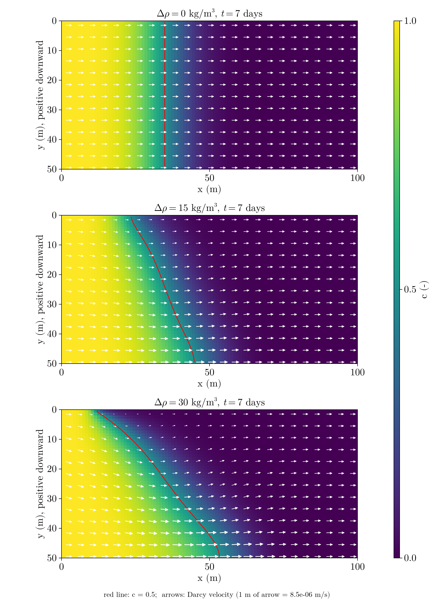
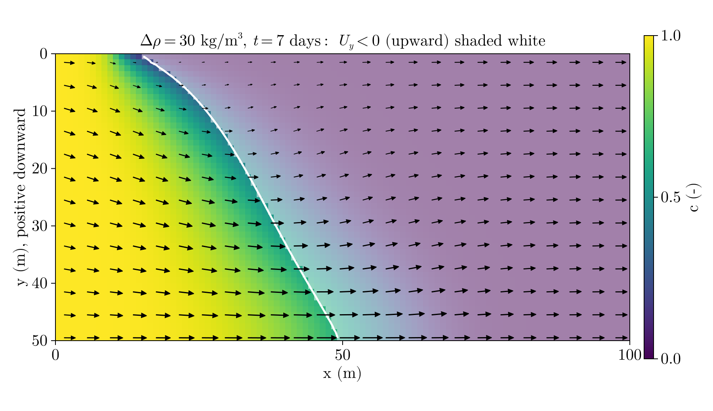

# Homework 6: Variable-Density Flow and Solute Transport

Viet M. Bui,
2026-10-29,
GLY 6826 - Hydrogeologic Modeling

Code source: [gh:vietbuiminh/hydro-modeling/](https://github.com/vietbuiminh/hydro-modeling/)

---

> [hw6.jl](hw6.jl) (coupled flow-transport solver in [funcs/variable_density_2d.jl](funcs/variable_density_2d.jl))

Given:

- $u_{in} = 0.1\ cm/min = 1.667\times10^{-5}\ m/s$ on the left (Neumann), $h_R = 9\ m$ on the right (Dirichlet), no-flow top and bottom,

- $k = 10^{-10}\ m^2$ (homog.) $\implies K = \frac{\rho g k}{\mu} = 9.81\times10^{-4}\ m/s$,

- $n_x = 100$, $n_y = 50$, $\delta x = \delta y = 1\ m$,

- $\rho = 1000\ kg/m^3$, $\mu = 10^{-3}\ Pa\ s$, $g = 9.81\ m/s^2$, $\phi = 0.3$,

- $D_{diff} = 10^{-9}\ m^2/s$ and $\alpha = 1\ m$ (isotropic), as in class and HW5,

- $c(x,y,0) = 0$; $c = 1$ on the left boundary for $t \le 10$ days, $c = 0$ afterward; $\partial c/\partial x = 0$ at the right outlet; zero advective and dispersive flux at the top and bottom.

Solve the variable-density flow and solute transport

*Governing equations.* Flow and transport are

$$
\frac{\partial(\rho\phi)}{\partial t} + \nabla\cdot(\rho\mathbf{u}) = 0, \qquad \frac{\partial(\phi C)}{\partial t} + \nabla\cdot\mathbf{F} = 0, \quad \mathbf{F} = \mathbf{u}C - \phi D_h\nabla C.
$$

c did not affect the flow ($h \to \mathbf{u} \to c$, one-way coupling). Here the density depends on $C$. Assuming a linear relationship,

$$
\rho = \rho_0 + \Delta\rho\,c = \rho_0(1 + \beta c), \qquad \beta = \frac{\Delta\rho}{\rho_0}, \quad 0 \le C \le 1,
$$

with $\rho_0 = 1000\ kg/m^3$ the freshwater density.

*Variable-density Darcy's law.* With $+y$ pointing down ($\mathbf{e}_y = [0,\ 1]^T$), Darcy's law in terms of pressure is

$$
\mathbf{u} = -\frac{k}{\mu}\left(\nabla p - \rho g\,\mathbf{e}_y\right).
$$

Introduce the equivalent freshwater head $h_f = \frac{p}{\rho_0 g} - y$, so $\nabla p = \rho_0 g\nabla h_f + \rho_0 g\,\mathbf{e}_y$:

$$
\mathbf{u} = -\frac{k}{\mu}\left(\rho_0 g\nabla h_f + (\rho_0 - \rho)g\,\mathbf{e}_y\right) = -\frac{k}{\mu}\left(\rho_0 g\nabla h_f - \rho_0 g\beta c\,\mathbf{e}_y\right) = -K\left(\nabla h_f - \beta c\,\mathbf{e}_y\right),
$$

with $K = \rho_0 g k/\mu$. $\implies$

$$
\begin{bmatrix} u_x \\ u_y \end{bmatrix} = -K\begin{bmatrix} \partial h_f/\partial x \\ \partial h_f/\partial y - \beta c \end{bmatrix}.
$$

Only the vertical flux changes.

*Boussinesq approximation.* Here $\beta = 0.015$ and $0.03$, so $\beta \ll 1$. The density difference affects groundwater flow mainly through buoyancy, so $\rho$ can be dropped from the continuity equation. For steady flow this gives $\nabla\cdot\mathbf{u} = 0$.

*Finite-volume form.*

$$
\begin{array}{cr|c|lc}
{} & {} & U & {} & {} \\
{} & {} & \downarrow Q_U & {} & {} \\ \hline
L & \overset{Q_L}{\longrightarrow} & \quad i \quad & \overset{Q_R}{\longrightarrow} & R \\ \hline
{} & {} & \downarrow Q_D & {} & {} \\
{} & {} & D & {} & {}
\end{array}
$$

$$
Q_L = T_L(h_L - h_i), \quad Q_R = T_R(h_i - h_R), \quad Q_U = T_U\left(h_U - h_i + \beta C_{f,U}\,\delta y\right), \quad Q_D = T_D\left(h_i - h_D + \beta C_{f,D}\,\delta y\right),
$$

with the face concentrations $C_{f,U} = 0.5(C_U + C_i)$ and $C_{f,D} = 0.5(C_i + C_D)$. The transmissibilities $T$ are the same as in HW4/HW5. The cell balance $-Q_L - Q_U + Q_D + Q_R = b_{bc}$ becomes

$$
-T_L h_L - T_U h_U + \Sigma_T h_i - T_D h_D - T_R h_R = b_{bc} + \underbrace{T_U\beta C_{f,U}\,\delta y - T_D\beta C_{f,D}\,\delta y}_{b_\rho}
$$
$$
\quad\Longrightarrow\quad \mathbf{T}\mathbf{h} = \mathbf{b}_{bc} + \mathbf{b}_\rho
$$

**Problem 1**

For $\Delta\rho = 0$, the problem is a homogeneous case. The front stays vertical and sits near $(u_{in}/\phi)\,t = 4.8\ m/day \times 7\ days = 33.6\ m$. For $\Delta\rho > 0$, the buoyancy term $K\beta c$ pushes the saline water down. The plume should therefore dive and travel farther along the bottom, while staying behind near the top. Because the fluid is incompressible and the bottom is no-flow, freshwater has to move up somewhere to make room. The larger $\Delta\rho$, the stronger and more tilted the effect should be.

- *Downward migration.* The $\beta C$ term in $\mathbf{u} = -K(\nabla h_f - \beta C\mathbf{e}_y)$ pulls the saline water down. None at $\Delta\rho = 0$, more at 30 than at 15.

- *Vertical flow.* $\Delta\rho = 0$: arrows are flat. With density, the arrows in the plume point down, more as $\Delta\rho$ goes up.

- *Upward return flow.* Ahead of the plume (freshwater, so no $\beta C$), the arrows tilt up, pushed only by $\partial h_f/\partial y$. None at $\Delta\rho = 0$.

- *Plume shape.* The front goes from vertical to tilted, with a saline tongue along the bottom. More tilt with bigger $\Delta\rho$.

- *Upper vs. lower portions.* The $c = 0.5$ front reaches:

| $\Delta\rho$ (kg/m³) | upper ($y = 0.5\ m$) | lower ($y = 49.5\ m$) |
|---|---|---|
| 0 | 34.8 m | 34.8 m |
| 15 | 23.5 m | 44.9 m |
| 30 | 11.8 m | 53.4 m |

With density, the bottom of the plume travels farther and the top lags behind, because $+K\beta C$ turns the flow inside the plume downward and toward the bottom.

**Problem 2**

| $\Delta\rho$ (kg/m³) | $\beta$ (-) | $\max\lvert U_y\rvert$ (m/s) | $\max\lvert\mathbf{U}\rvert$ (m/s) |
|---|---|---|---|
| 0 | 0 | $\approx 0$ ($10^{-17}$, round-off) | $1.667\times10^{-5}$ |
| 15 | 0.015 | $3.25\times10^{-6}$ | $2.41\times10^{-5}$ |
| 30 | 0.030 | $6.14\times10^{-6}$ | $2.98\times10^{-5}$ |

- *Does vertical velocity increase approximately linearly with $\Delta\rho$?* Yes, doubling $\Delta\rho$ from 15 to 30 increases $\max|U_y|$ by a factor of almost 2.

- In $u_y = -K(\partial h_f/\partial y - \beta C)$, only $\beta$ scales directly with $\Delta\rho$. $\partial h_f/\partial y$ is not fixed. The head field adjusts to the sinking plume and opposes the $\beta C$ term, and how much it opposes depends on the plume's shape. $C$ is not fixed either. The flow moves the solute, so a larger $\Delta\rho$ gives a different (more tilted, more spread-out) concentration field by day 7. Since $\partial h_f/\partial y$ and $C$ both change with $\Delta\rho$, $u_y$ is not simply proportional to $\beta$.

**Problem 3**

The $U_y < 0$ region lies ahead of the plume front, from the white $U_y = 0$ line (about $x = 16\ m$ at the top to $x = 49\ m$ at the bottom) to the outlet.

1. The upward flow is in the freshwater, not the saline water. Where $C \approx 0$, $u_y = -K\,\partial h_f/\partial y$: there is no buoyancy, and the flow follows the head gradient. The sinking plume pushes water against the no-flow bottom. That raises $h_f$ at depth ahead of the plume, so $\partial h_f/\partial y > 0$ there, which gives $u_y < 0$ (upward). The dense water sinks, and it pushes the lighter freshwater up.

2. The fluid is incompressible, so water cannot pile up anywhere, and the top and bottom are no-flow. Any water moving down inside the plume must be balanced by the same amount of water moving up somewhere else. That return flow is the upward flow ahead of the plume.

3. *Circulation pattern around the dense plume:*

